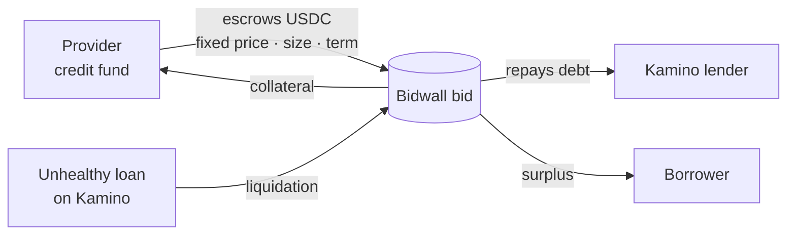
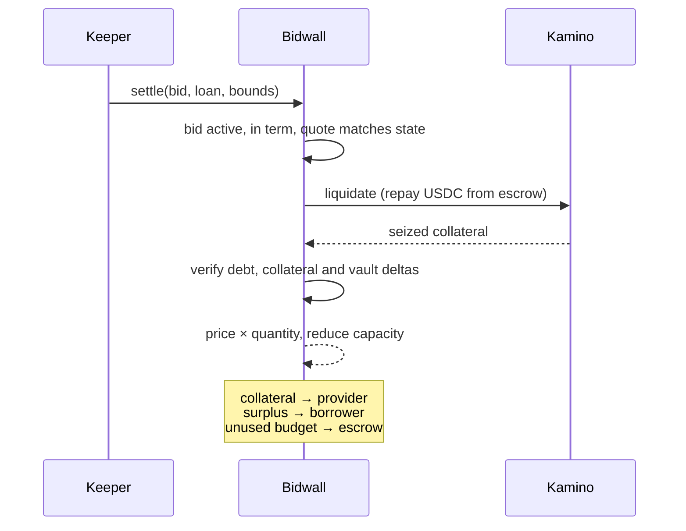

# Bidwall

**Committed exit liquidity for tokenized credit used as collateral on Solana.**

Credit funds post funded, fixed-price bids for RWA collateral. When a lender
liquidates a loan, the bid buys the collateral inside the same transaction, so
the lender is repaid without relying on DEX depth.

[Explore the hosted demo](https://bidwall-omega.vercel.app) · [Reproduce locally](#run-it)

> Hackathon prototype. Runs on a local mainnet fork and offline replays of real
> Kamino state. Not deployed to mainnet.

## In plain English

_Illustration using the demo's real settlement amounts._

Alice holds ONyc, a token that earns reinsurance yield. She deposits it on Kamino,
a Solana lending app, and borrows USDC against it.

If ONyc's price falls far enough, her loan becomes unsafe and Kamino
**liquidates** it: it takes some of her ONyc and sells it to repay the lender.
One exit is a DEX. Our 12 October Jupiter snapshot quoted a $5M ONyc sale
43% below oracle value. That route can consume a liquidation's entire margin;
other routes, including OnRe's own liquidity engine, may offer better execution.

Bidwall gives that sale a buyer who is already waiting. A credit fund locks
$4,700 in advance with a promise: _"I'll buy up to 5,000 ONyc at $0.94."_ When
Alice's loan is liquidated, in one transaction:

- $1,014.07 comes out of the fund's locked money
- $1,000.00 repays the lender
- $14.07 goes back to Alice
- the fund receives 1,078.79 ONyc

No DEX is involved. The bid is below the test's $0.95 oracle price. A provider
with redemption access could seek to earn the discount, while taking credit,
price and redemption-delay risk. These are demonstration terms, not a quote
from an independent fund.

## The problem

About **$446M** is borrowed on Kamino against tokenized credit and RWA tokens
(tokenized stocks: $5.2M). A lender can only accept collateral it can sell when a
loan goes bad (a liquidation), and much of this collateral can't be sold at size:

| Collateral on Kamino    | Collateral | Cost to sell $5M on Jupiter |
| ----------------------- | ---------: | --------------------------: |
| ONyc (OnRe reinsurance) |    $155.7M |                    **−43%** |
| USDe                    |    $151.2M |                    **−80%** |
| AUTO                    |     $78.1M |                    **−98%** |
| FWDI (Superstate)       |     $22.7M |         **no route at all** |
| PRIME, syrupUSDC, PST   |          — |     ≤ −0.2% (issuer-funded) |

These are quoted snapshots, not executed trades or proof of bad debt. OnRe
already offers another route: its [liquidity engine](https://www.onre.finance/blog/introducing-onres-liquidity-engine-powered-by-titan)
allocates **~15% of its underwriting capital** to ONyc liquidity, with dynamically
priced quotes routed through Titan. Bidwall explores sourcing committed capacity
from outside providers instead of requiring the issuer to fund all of it.

## The solution

Bidwall turns that exit into a product someone else can supply. A provider (a
credit fund or market maker) locks USDC in a bid: _"I will buy up to 5,000 ONyc at
$0.94 until Friday."_ The funds can't be withdrawn early, so lenders and risk teams
can count on them.



**Why focus on credit.** A slower-moving redemption value can make standing bids
easier to price. A provider with redemption access can seek a discount, but still
takes credit risk and locks capital until expiry. Whether issuers will pay for
this capacity and providers will supply it at useful terms remains unvalidated.

## How a settlement works

One transaction, signed by a keeper. Bidwall calls Kamino's own liquidation
instruction (`liquidate_obligation_and_redeem_reserve_collateral_v2`) and checks
every balance before and after. If any check fails, the whole transaction reverts,
including Kamino's side.



## Proof: a real ONyc loan

A real looped ONyc loan at 66% LTV, from mainnet state:

1. Kamino **refuses** to liquidate it: it's healthy (65.4% LTV).
2. In the offline replay, we lower ONyc's oracle price to $0.95, Kamino's floor.
3. A $0.94 bid settles part of the loan in one transaction:

| Leg                                |                 Amount |
| ---------------------------------- | ---------------------: |
| Paid from the bid escrow           |          1,014.07 USDC |
| → debt repaid to the Kamino lender |          1,000.00 USDC |
| → surplus paid to the borrower     |             14.07 USDC |
| ONyc delivered to the provider     | 1,078.79 ONyc at $0.94 |

No DEX was involved. This proves a $1,000 repayment, not a $5M liquidation or
committed capacity at that scale. The same flow also runs for NVDAx (tokenized Nvidia).

## What's built

- **Anchor program**: funded bids with partial fills, expiry, refunds and
  exhaustion; settlement into Kamino Lending v2 for ONyc/USDC and NVDAx/USDC.
- **Offline replays** of both liquidations against the deployed Kamino binaries.
  45 Rust tests and 6 client tests, no network needed.
- **Web console** that runs the whole lifecycle: fund, blocked early withdrawal,
  blocked healthy-loan liquidation, settlement, exhaustion, expiry.
- **Risk research**: every xStock loan on Kamino and Jupiter Lend measured against
  live exit depth. That's what moved us from stocks to credit
  ([stocks](docs/research/2026-10-12-jupiter-lend-exposure.md),
  [credit](docs/research/2026-10-12-rwa-collateral-wedge.md)).

## Run it

Needs the [toolchain](docs/TOOLCHAIN.md), Surfpool 1.3.0, Node.js and pnpm 12.5.1.

```sh
pnpm install --frozen-lockfile --ignore-scripts
npm run anchor-test   # program build + 45 tests, including both Kamino replays
npm run dev:demo      # console at http://127.0.0.1:3000
```

To replay the ONyc liquidation against live mainnet state on a fork:

```sh
npm run anchor-build && npm ci --prefix spikes/kamino-cpi
NO_DNA=1 surfpool start --port 18899 --ws-port 18900 --no-deploy --no-tui --airdrop-amount 0
PAIR=onyc node spikes/kamino-cpi/scenario.mjs   # in another terminal
```

## Limits

- Fork and replay only: no mainnet deployment, no audit.
- Two supported pairs. Permissioned tokens (allowlists, transfer hooks) are next.
- No issuer or provider has signed up yet. The demand evidence is OnRe's in-house
  engine and the measured exit depth above.
- Kamino liquidations are open to anyone. A bid fills only when it's the best exit.

[Status](docs/STATUS.md) · [Kamino integration](docs/KAMINO-INTEGRATION.md) ·
[Operator demo](docs/OPERATOR-DEMO.md) · [Risk monitor](docs/RISK-MONITOR.md) ·
[Research](docs/research/)
